# DataSetu Architecture & System Design

DataSetu is a high-performance open-source compiler engine that transforms messy Indian public data files (CSV, TSV, XLSX) from `data.gov.in` and state portals into clean, versioned REST APIs and typed Python SDKs with **one command**.

---

## 1. High-Level Architecture

DataSetu operates as a **deterministic 4-stage compiler pipeline** with no runtime LLM dependencies in the core data path:

```mermaid
flowchart TD
    A["Raw Source (CSV / XLSX / Portal URL)"] --> B["Stage 1: Smart Sniffer"]
    B -->|Cleaned In-Memory Matrix| C["Stage 2: Bharat Normalizer"]
    C -->|LGD Crosswalk & Indian Numerics| D["Stage 3: Columnar Ingestion"]
    D -->|DuckDB Thread-Safe Memory| E["Stage 4: Dynamic Router & CDC"]
    E --> F["OpenAPI 3.1 & REST API"]
    E --> G["Offline Interactive Web UI"]
    E --> H["Typed Python Client SDK"]
    E --> I["Async CDC Worker"]
```

---

## 2. Compiler Pipeline Stages

### Stage 1: Smart Sniffer (`sniffer.py`)
- **Encoding Detection**: Scans raw bytes with `chardet` and checks byte-order marks (`UTF-8`, `UTF-8-BOM`, `CP1252 / Windows-1252`, `Latin-1`). Solves common portal character corruption like Windows en-dash (`\x96` $\to$ `–`).
- **Delimiter Detection**: Evaluates delimiter consistency and variance across candidate characters (`,`, `\t`, `;`, `|`).
- **Preamble Stripping**: Identifies decorative ministry headers, file metadata banners, and comment lines (`#`, `//`) before tabular data starts.
- **Merged Header Repair**: 
  - Unrolls Excel merged cell ranges (`ws.merged_cells.ranges`) into unified coordinates.
  - Detects split 2-row headers, forward-fills parent headers across spans, and concatenates child sub-headers into explicit unique names (e.g. `Administrative Hierarchy - State`).
- **DuckDB Stage**: Ingests into an in-memory Arrow table with `all_varchar=true` so the normalizer controls all typing deterministically.

### Stage 2: Bharat Normalizer (`normalizer.py`)
- **Indian Numeral Parsing**:
  - Lakhs: `2.5 Lakhs` $\to$ `250000.0`, `1.5 Lacs` $\to$ `150000.0`
  - Crores: `12 Crores` $\to$ `120000000.0`, `10 Cr` $\to$ `100000000.0`
  - Indian Commas: `12,34,567` $\to$ `1234567`, `1,45.20*` $\to$ `145.20`
  - Accounting Negatives: `(1,234)` $\to$ `-1234`
  - Sentinels & Missing: `NA`, `N.A.`, `Nil`, `-`, `--` $\to$ `None` (Arrow null)
  - **80% Rule**: Converts a column to numeric (`int64` or `float64`) only if $\ge 80\%$ of its non-null values parse cleanly; otherwise preserves original text.
- **Bharat Entity Intelligence & LGD Crosswalk**:
  - Seeds the official Local Government Directory (LGD) district gazetteer (`lgd_districts.json`).
  - Resolution precedence: `Exact Normalized Name` $\to$ `Alias Table` $\to$ `Deterministic RapidFuzz` $\to$ `Unmatched`.
  - **State Disambiguation**: Resolves same-named districts (e.g. Bilaspur in Himachal Pradesh vs. Chhattisgarh) using state column hints.
  - **Honesty Guardrail**: Ambiguous matches with no state hint return `unmatched` (never guesses).
  - Appends 5 canonical LGD columns: `lgd_state_code`, `lgd_district_code`, `lgd_district_name`, `lgd_match_method`, `lgd_match_score`.

### Stage 3: In-Memory Storage & Atomic Swaps (`db.py`)
- **Columnar Engine**: DuckDB executes in-process queries directly over PyArrow record batches with zero network latency.
- **Parameterized SQL**: Enforces SQL injection safety, case-insensitive text equality, comparator filters (`__gte`, `__lte`), full-text search (`q`), and sorting (`-col`).
- **1-Indexed Pagination**: `page=1` returns the first slice (`offset = 0`), eliminating off-by-one errors common in portal APIs.
- **Atomic Zero-Downtime Swaps**: When Change Data Capture triggers a dataset refresh, a new DuckDB table is constructed in memory, validated, atomically committed in a transaction, and versioned (`1.0.0` $\to$ `1.0.1`).

### Stage 4: Router, SDK & CDC
- **Dynamic OpenAPI 3.1 & Router (`router.py`)**: Spawns FastAPI routes with dynamically constructed Pydantic v2 schemas (`create_model`). Serves `/v1/data`, `/v1/data/summary`, `/v1/schema`, `/v1/report`, `/v1/changelog`, and `/docs`.
- **Offline Demo Web UI (`static/index.html`)**: 100% self-contained HTML/CSS/JS page rendering Before/After comparisons with zero CDN or external web font dependencies (Rule R8).
- **SDK Synthesis (`sdk_generator.py`)**: Uses Jinja2 templates to compile `datasetu_client.py`, complete with typed dataclasses, pagination iterators, and connection pooling.
- **Async CDC Worker (`cdc.py`)**: Evaluates HTTP `ETag` / `Last-Modified` via conditional `HEAD` requests (receiving `304 Not Modified` when unchanged) or local file `mtime` + SHA-256 hashes.

---

## 3. Why DataSetu Differs from Existing Tools

| Capability | Datasette (SQLite) | Traditional ETL / Pandas | DataSetu |
| :--- | :--- | :--- | :--- |
| **Storage Architecture** | Row-oriented SQLite B-Trees | In-memory Pandas DataFrames | **Columnar In-Memory DuckDB (Vectorized SIMD)** |
| **Analytical Aggregations** | Slow on large scans | High memory overhead | **Sub-millisecond group-by and metrics (< 2ms)** |
| **Indian Numerals** | No awareness (stores as text) | Manual regex scripts required | **Built-in Lakhs/Crores/Rupee parser** |
| **Administrative Crosswalk** | None | Manual join required | **Official LGD Gazetteer entity resolution** |
| **API Synthesis** | SQLite table viewer | Requires custom FastAPI code | **Instant OpenAPI 3.1 + Pydantic v2 Models** |
| **SDK Generation** | None | Manual client maintenance | **One-command typed Python SDK client** |
| **Change Data Capture** | Static file mounts | Polling cron scripts | **Conditional HTTP HEAD & atomic table swap** |
